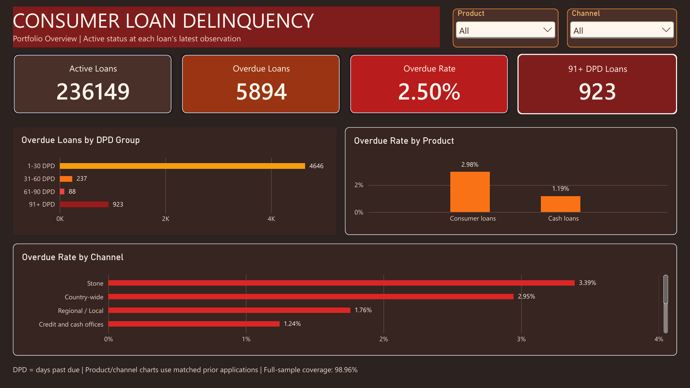
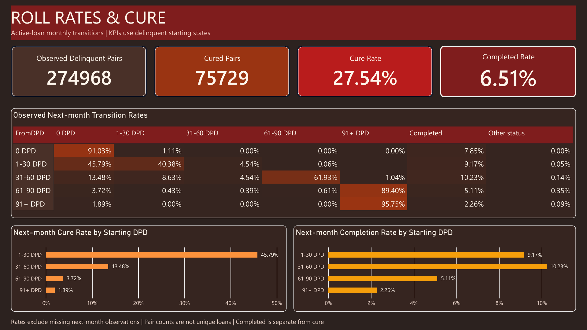
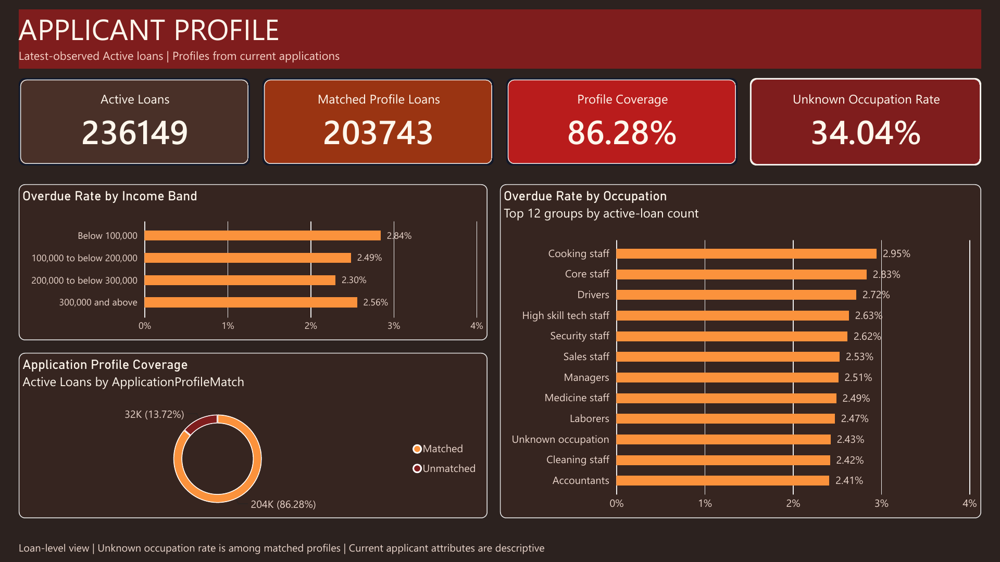

# Consumer Loan Delinquency & Roll-rate Analysis

A data analytics portfolio project using **SQL Server, Power BI, and DAX** to describe overdue consumer loans, monthly delinquency transitions, and applicant-profile coverage.

The project uses the public **Home Credit Default Risk** dataset. It is a descriptive analysis of historical observations, rather than a predictive default model or a report about a current bank portfolio.

## Business questions

1. What is the DPD distribution of latest-observed Active contracts?
2. How do overdue rates differ across products and acquisition channels?
3. How do Active contracts move between DPD groups in consecutive months?
4. How often do delinquent observations return to Active 0 DPD, and how often do they transition to Completed?
5. How do overdue rates vary by current application income and occupation, and how complete is the profile linkage?

## Dashboard pages

| Page | Focus |
|---|---|
| Portfolio Overview | Latest-observed Active contracts, overdue and 91+ DPD counts, and product/channel comparisons. |
| Roll Rates & Cure | A next-month transition matrix, cure rates, and completion rates from delinquent starting states. |
| Applicant Profile | Income and occupation comparisons, current-profile match coverage, and unknown occupations. |

View the [dashboard PDF](Consumer_Loan_Risk_Analysis.pdf), open the [Power BI report](Consumer_Loan_Risk_Analysis.pbix), or read the [insights and recommendations](insights.md).

## Selected results

| Metric | Result | Population |
|---|---:|---|
| Active contracts | 236,149 | Each contract's latest observed record, filtered to Active. |
| Overdue contracts | 5,894 | Latest-observed Active contracts with DPD greater than zero. |
| Overdue rate | 2.50% | Overdue contracts divided by Active contracts. |
| 91+ DPD contracts | 923 | Latest-observed Active contracts with DPD of at least 91. |
| Observed delinquent pairs | 274,968 | Valid consecutive-month pairs starting at 1-30 DPD or worse. |
| Next-month cure rate | 27.54% | 75,729 pairs returning to Active 0 DPD, divided by observed delinquent pairs. |
| Next-month completion rate | 6.51% | 17,913 pairs transitioning to Completed, divided by observed delinquent pairs. |
| Current-profile coverage | 86.28% | 203,743 matched contracts out of 236,149 Active contracts. |
| Unknown occupation rate | 34.04% | 69,364 contracts with unknown occupations among 203,743 matched contracts. |

Early delinquency accounts for **78.83% of overdue contracts**. The next-month cure rate falls from **45.79% at 1-30 DPD** to **1.89% at 91+ DPD**. These are descriptive findings; the project does not estimate the effect of a collection action.

## Data

Source: [Home Credit Default Risk on Kaggle](https://www.kaggle.com/competitions/home-credit-default-risk/data).

| Source file | Rows | Use |
|---|---:|---|
| POS_CASH_balance.csv | 10,001,358 | Monthly contract status, relative observation month, and days past due. |
| previous_application.csv | 1,670,214 | Product, acquisition channel, and application identifiers. |
| application_train.csv | 307,511 | A four-column projection containing application ID, income amount, income type, and occupation. |

Raw source data is obtained separately from Kaggle. The small Q3 result CSV is derived from the SQL analysis and supplies the historical transition table in Power BI.

## Methodology

### Data preparation and validation

- Import raw CSV values and convert the required numeric fields in SQL Server.
- Preserve missing instalment values as NULL and check invalid conversions separately from missing values.
- Check the contract-month grain and reconcile row counts and grouped results.
- Keep unmatched previous applications and unmatched current profiles visible in coverage checks.

### Latest-observed portfolio

Use ROW_NUMBER over all monthly statuses to select the latest observation for each SK_ID_PREV, then filter to Active. Join previous-application attributes using contract and application IDs, and current application profiles using SK_ID_CURR.

The overall KPIs retain unmatched contracts. Product/channel charts use matched previous applications, with **98.96% coverage**. Income/occupation charts use matched current profiles, with **86.28% coverage**.

### Historical monthly transitions

Use the next observation across all statuses, then retain Active starting observations. A valid pair requires the same contract and application ID and an observation exactly one month later. Missing observations and month gaps are excluded from rate denominators.

The transition matrix retains observed Completed and Other status destinations in each starting group's denominator. Cure and completion KPIs use delinquent starting groups only, and overall rates are calculated from counts rather than by averaging group percentages.

### Power BI model

- **LoanProfile:** 236,149 rows, one per latest-observed Active contract; used on Portfolio Overview and Applicant Profile.
- **RollRates:** 39 aggregated transition-result rows; used on Roll Rates & Cure.

The tables remain separate because they have different grains and populations. The aggregated historical table does not support product/channel breakdowns. DAX measures use explicit filter context to retain the intended denominators.

## Project files

| File | Purpose |
|---|---|
| README.md | Project overview, methods, results, and interpretation. |
| [analysis.sql](analysis.sql) | Original data preparation, validation, and five-question SQL analysis. |
| [insights.md](insights.md) | Findings, recommendations, and detailed interpretation limits. |
| [Consumer_Loan_Risk_Analysis.pbix](Consumer_Loan_Risk_Analysis.pbix) | Interactive Power BI report and imported model. |
| [Consumer_Loan_Risk_Analysis.pdf](Consumer_Loan_Risk_Analysis.pdf) | Exported three-page report. |
| [q3_roll_rate_results.csv](q3_roll_rate_results.csv) | The 39-row SQL output imported as RollRates. |

## Dashboard Preview

### 1. Portfolio Overview

### 2. Roll Rates & Cure

### 3. Applicant Profile

## Interpretation limits

- **Counting unit.** Portfolio counts are based on contracts (`SK_ID_PREV`). A single contract can contribute several monthly transition pairs.
- **Observation timing.** The latest available observation is selected for each contract, so observation months may differ across contracts. `MONTHS_BALANCE` is relative to the current application.
- **Overdue, cure, and completion.** The overdue rate measures the share of active contracts with at least one day past due (DPD). A cure is a return to active status with zero DPD. The completion rate tracks transitions to `Completed`.
- **Applicant profiles.** Income and occupation come from the current application and may reflect a later point in time than earlier loan observations. The comparisons describe overdue rates among contracts with matched profiles. Income bands use the units in the source dataset.
